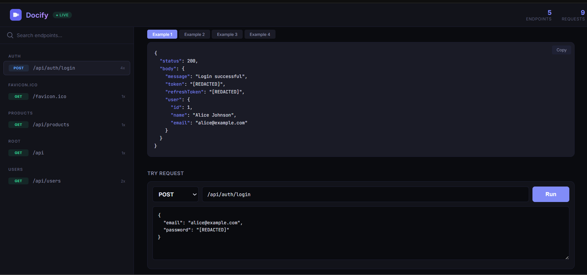

<p align="center">
  
  
  
  
</p>

<h1 align="center">📄 Docify</h1>

<p align="center">
  <strong>Zero-config Express.js middleware that automatically generates API documentation from runtime usage.</strong>
</p>

<p align="center">
  No Swagger. No OpenAPI. No schemas. No decorators.<br/>
  Just install it, use Express normally, and documentation appears.
</p>

---

<!-- dashboard image -->

## ⚡ Quick Start

```bash
npm install docify
```

```js
const express = require('express');
const docify = require('@alikhan-devs/docify');

const app = express();
app.use(express.json());

// One line — that's it!
app.use(docify());

// Your existing routes work as before
app.get('/api/users', (req, res) => { /* ... */ });
app.post('/api/users', (req, res) => { /* ... */ });

app.listen(3000);
// Visit http://localhost:3000/docs to see your auto-generated API docs!
```

## 🎯 How It Works

1. **You install Docify** and add it as Express middleware
2. **You develop normally** — no annotations, no schemas, no changes to your code
3. **Docify observes** every API request and response flowing through your app
4. **Documentation is generated** automatically and served at `/docs`
5. **Live updates** — as you make more API calls, docs update in real-time via SSE

## 📋 Configuration

```js
app.use(docify({
  docsPath: '/docs',          // URL path for documentation UI (default: '/docs')
  sanitize: true,             // Mask sensitive fields like passwords/tokens (default: true)
  enabled: true,              // Master switch (default: true)
  maxExamples: 5,             // Max request/response examples per endpoint (default: 5)
  sensitiveFields: [],        // Additional field names to redact (default: [])
  ignorePaths: ['/health'],   // Paths to exclude from capture (default: [])
  captureHeaders: false,      // Whether to capture req/res headers (default: false)
  persist: true,              // Keep captured docs after server restarts (default: true)
  storagePath: '.docify/docify.json', // Optional custom persistence file
}));
```

### Environment Variables

| Variable | Description |
|---|---|
| `DOCIFY_ENABLED=false` | Disable Docify entirely (useful for production) |
| `DOCIFY_DEBUG=true` | Enable internal debug logging |

## 🏗️ Architecture

```
Express Request → Capture Middleware → Sanitizer → Route Registry → Doc Generator → UI
```

| Module | Responsibility |
|---|---|
| **Capture Middleware** | Intercepts `res.write`/`res.end` to capture response bodies non-destructively |
| **Route Registry** | In-memory store that groups API calls by normalized routes, detects parameterized paths |
| **Sanitizer** | Deep-scans objects and masks sensitive fields (`password`, `token`, `secret`, etc.) |
| **Doc Generator** | Transforms registry data into structured, sorted, grouped JSON |
| **UI Server** | Serves a self-contained HTML documentation page with SSE live updates |

## Persistent Docs, Cleanup, and Try It

Docify now stores captured documentation in `.docify/docify.json` by default, so restarting your backend does not wipe the generated docs. Set `persist: false` if you only want in-memory docs during tests or short-lived sessions.

If a wrong request is captured, such as `GET /users` when the endpoint should be `POST /users`, open the endpoint in the UI and use the delete button to remove only that captured route.

Each endpoint page also includes a try panel. You can edit the method, path, query string, and JSON body, then run the request against the live backend and see the real response immediately.

### Parameterized Route Detection

Docify automatically detects dynamic URL segments:

- `/users/123` → `/users/:id`
- `/users/550e8400-e29b-41d4-a716-446655440000` → `/users/:id`
- `/users/507f1f77bcf86cd799439011` → `/users/:id`

## 🔒 Security

- **Sensitive fields are masked by default** — passwords, tokens, API keys, secrets are replaced with `[REDACTED]`
- **No external network calls** — all data stays in-process memory
- **Response body size limit** — bodies >1MB are truncated
- **Self-exclusion** — Docify's own routes are never captured
- **Production disable** — set `DOCIFY_ENABLED=false` in production

### Default Redacted Fields

`password`, `token`, `access_token`, `refresh_token`, `api_key`, `secret`, `authorization`, `cookie`, `session`, `credit_card`, `card_number`, `cvv`, `ssn`, `private_key`, `x-api-key`

## 📡 API Endpoints

When Docify is mounted, these routes are available:

| Route | Description |
|---|---|
| `GET /docs` | Documentation UI |
| `GET /docs/api.json` | Raw JSON API catalog (SDK-friendly) |
| `GET /docs/stream` | Server-Sent Events stream for live updates |
| `DELETE /docs/api.json` | Clear all captured data |
| `DELETE /docs/endpoint` | Delete one captured endpoint by `method` and `path` |
| `POST /docs/try` | Run an endpoint against the live backend from the docs UI |

## 🧪 Running the Example

```bash
cd example
npm install
npm start
```

Then make some API calls:

```bash
curl http://localhost:3000/api/users
curl -X POST http://localhost:3000/api/users -H "Content-Type: application/json" -d '{"name":"Alice","email":"alice@test.com"}'
curl http://localhost:3000/api/products?category=electronics
curl -X POST http://localhost:3000/api/auth/login -H "Content-Type: application/json" -d '{"email":"alice@example.com","password":"secret"}'
```

Visit `http://localhost:3000/docs` to see the auto-generated documentation!

## 📄 License

MIT
